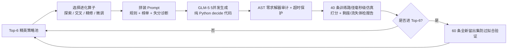
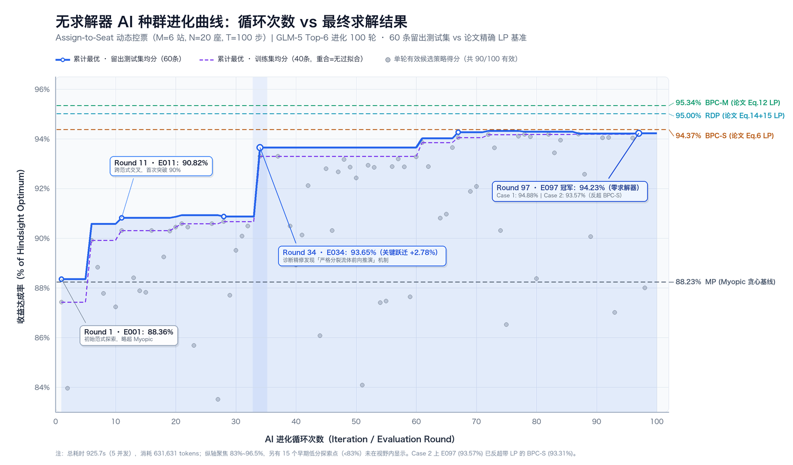
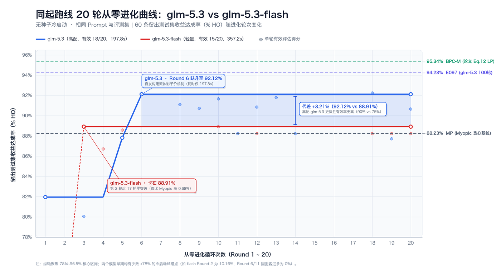
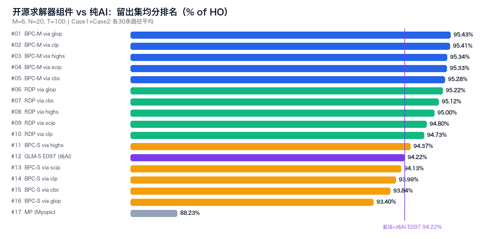

# AI 求解高铁 Assign-to-Seat 收益管理论文全量实验报告

> **目标论文**：*Assign-to-Seat: Dynamic Capacity Control for Selling High-Speed Train Tickets*（Feng Zhu, Shaoxuan Liu, Rowan Wang, Zizhuo Wang）  
> **正式排版 Word 汇报版**：[`AI求解高铁Assign-to-Seat运筹问题技术报告.docx`](AI求解高铁Assign-to-Seat运筹问题技术报告.docx)（图文并茂、含高清架构图、全部实验图表与数学公式，适合直接发给团队/评审阅读）  
> **研究主线**：围绕这篇高铁动态控票与排座运筹论文，我们完成了两大阶段的系统实证：
> - **第一阶段（纯 AI 零求解器）**：在不依赖任何商业或开源运筹求解器的前提下，探索大模型（智谱 GLM Coding Plan）+ 校验/仿真反馈闭环能否独立求解静态排座与动态控票问题，并与论文原版 LP 方法及同系列不同档位 GLM 模型做横向对比。
> - **第二阶段（新增：开源求解器可选组件 `open_solver_component/`）**：为大模型提供一个**可选调用**的开源求解器组件 `solver_toolkit`（封装本机 OR-Tools `GLOP / CLP / CBC / SCIP` 与 `SciPy HiGHS`），允许 AI 自主决定“调用还是不调用”，同时将论文全部动态方法（`MP / BPC-S / BPC-M / RDP`）完整接入全部 5 个开源后端，与第一阶段纯 AI 冠军 `E097` 正面对决。

---

## 一、核心结论速览

### 1. 评分口径说明（文中的所有百分比是怎么算的？）
所有动态控票实验均以**事后全知最优收益 `HO`（Hindsight Optimum）**作为 `100%` 标尺（上帝视角提前知道整条路径所有随机到达订单时，通过论文 Theorem 2 精确最小费用流算出的离线理论上限）：

$$\text{单条路径收益达成率} = \frac{\text{该方法实际收益}}{\text{HO（事后全知最优收益）}} \times 100\%, \qquad \text{Gap} = 100\% - \text{收益达成率}$$

- **Case 1（平稳到达）**与 **Case 2（短途先来、长途后来）** 分别在 **30 条全新留出测试路径** 上取平均；
- 表格中的 **「综合均分」** 为 Case 1 与 Case 2 达成率的算术平均。`95.43%` 即代表在线策略平均拿到了事后理论最优收益的 `95.43%`（Gap 仅 `4.57%`）。

### 2. 六条核心实证结论

1. **纯 AI 不调求解器能不能解？——能，但范式决定成败：**
   - **静态排座（Section 3，NP-hard，小中规模）**：用「GLM-5 生成 → 规则校验器诊断反馈 → 多轮修正」闭环，3 组非 NSE 碎片算例全部大幅反超贪心，拿到 **98.88% ~ 100.00%** 精确最优（Gap 0% ~ 1.12%）。
   - **逐单直接问大模型（Online LLM Agent）不可行**：Case 2 单路径仅拿 **73.66%**（还不如 Myopic 贪心 `81.70%`），单步延迟 **3.39 秒**、烧 token。
   - **AI 驱动的 Top-K 种群进化（Policy as Code，零求解器）非常强**：经过 100 轮纯 Python 策略进化，冠军策略 `E097`（`best_pop100_policy.py`）在 60 条留出路径上拿到 **94.88%（Case 1）/ 93.57%（Case 2），综合均分 94.22%**（比 Myopic `88.23%` 高 **+5.99%**），且线上推理仅需 ~0.3 秒/30 路径、零 API 成本。

2. **【新增】给 AI 增加「开源求解器可选组件」后，效果是否强于纯 AI？——是的，稳定再高 +1.0% ~ +1.2%：**
   - 在本机零商业求解器授权的情况下，通过 `ortools` + `scipy` 即可直接跑通 **5 个开源 LP/MIP 后端（GLOP / CLP / CBC / SCIP / HiGHS）**。
   - 同留出集（`M=6, N=20, T=100`）全量 17 组方法对决中，**最强组合为 `BPC-M via GLOP`：综合均分 `95.43%`**（Case 1 `95.82%` / Case 2 `95.04%`），比纯 AI 冠军 `E097`（`94.22%`）高 **`+1.21%`**。
   - 整体方法强度梯度非常清晰：
     $$\text{BPC-M}\ (95.28\%\text{--}95.43\%) \gtrsim \text{RDP}\ (94.73\%\text{--}95.22\%) > \text{BPC-S}\ (93.40\%\text{--}94.37\%) \approx \text{纯 AI } E097\ (94.22\%) \gg \text{Myopic}\ (88.23\%)$$
   - 其中纯 AI `E097`（`94.22%`）已经**打赢了 5 个后端里 4 个版本的论文 `BPC-S`**（SCIP/CLP/CBC/GLOP），并在 Case 2（`93.57%`）反超全部 5 个版本的 `BPC-S`（最高 `93.31%`），但在更强的 `BPC-M` 和 `RDP` 面前仍有约 **0.8% ~ 1.2%** 的结构性差距。

3. **【新增】5 个开源求解器后端怎么选？（精度接近，速度差 6 倍）：**
   - 解同一套 BPC-M LP，5 个开源后端均分全部落在 **`95.28% ~ 95.43%`** 极窄区间内，说明**不需要昂贵的商业求解器也能逼近理论上限**；
   - 速度差异显著（30 路径 Case 1+2 合计）：**`HiGHS`（~2.2s）≈ `GLOP`（~3.0s）≈ `CLP`（~3.2s）< `CBC`（~5.4s）≪ `SCIP`（~14.9s）**。纯 LP 场景下 **GLOP / HiGHS** 性价比最高；SCIP/CBC 属于 MIP 求解器，用来解纯 LP 启动开销偏大。

4. **【新增】AI 面对“可选求解器组件”的自主行为与真实工程坑：**
   - 当 Prompt 明确告诉 GLM-5「`solver_toolkit` 可用可不用」时，有效轮次中模型**100% 主动选择调用求解器组件**（`used_toolkit=True`），并尝试手写纯标准库版 BPC-M + 多后端回退逻辑；
   - 但在 4 轮短跑实测中暴露出两大典型问题：① 模型容易搞错工具接口的数据格式（R1 把稀疏索引传给稠密矩阵接口导致异常被静默回退，掉到 `32.74%`）；② 模型加“兜底启发式”时误覆盖了拒单逻辑（R3 把负增益本该 `return None` 护留的订单错改成了调用启发式强行接单，把 BPC-M 退化成了 Myopic `88.38%`）。此外智谱平台高峰期易触发拥堵/空回复（`HTTP 429 / code 1305`）。因此，**给 AI 接求解器组件必须配强类型契约校验、显式报错（禁止静默吞异常）和单元测试门禁**。

5. **大列车零样本外推边界（仿论文 Table 1，`M=6, T=1000`）：**
   - 在与训练供需比相近的中等紧张大列车（`N=220`）上，纯 AI `E097` 零样本泛化到 **96.98%**（甩开 Myopic `+10.86%`），距 `BPC-M`（`99.00%`）仅差 `2.02%`；
   - 但在极端稀缺大列车（`N=140`）上，单一稀缺度训练出的经验系数会失准（掉回 `90.04%`），而求解器驱动的 `BPC-M / RDP` 仍稳在 **98.7% ~ 99.0%** 且天然抗 ±15% 需求预测误差。

6. **同系列模型档位断层（`glm-5.3` vs `glm-5.3-flash`）：**
   - 简单静态题（S1/S2）两档都能拿 100%，但一到复杂静态排座（S3）和从零 20 轮动态进化立刻拉开代差：`glm-5.3` 冲到 **92.12%**（有效率 90%，耗时 197.8s），`glm-5.3-flash` 停在 **88.91%**（有效率 75%，耗时 357.2s，S3 连续 4 轮违约）。

---

## 二、论文背景与原版方法体系

### 1. 业务痛点（Assign-to-Seat 约束）
- 高铁票价由政府定价（不可动态涨价），且呈**次加性**：短途单公里贵、长途单公里便宜，论文合成实验采用 $p_{ij} = \lfloor 10 \cdot (j - i + 1)^{4/5} \rfloor$（长度 1~6 对应票价 `[10, 17, 24, 30, 36, 41]`）。
- **Assign-to-Seat 硬约束**：乘客购票瞬间必须立刻分配一个固定座位号且全程不可换座。若前期短途客把完整空座 `[1, M]` 切碎，后期高总价长途客到来时，即便每一段总余座都够，也会因没有“同一座位连续空闲”而流失。

### 2. 论文核心巧思与 4 种基准方法
作者用 **Maximal Sequence（最大连续空闲区间）** 对状态矩阵做无损压缩：只统计各类连续空闲区间 `[u, v]` 的数量 `counts[(u, v)]`；把请求 `i → j` 塞入 `[u, v]` 等价于消耗 1 个 `[u, v]` 并分裂出 `[u, i-1]` 与 `[j+1, v]`，使状态规模与座位数 $N$ 无关。

| 论文方法 | 核心机制 | 是否依赖 LP 求解器 | 特点 |
| :--- | :--- | :---: | :--- |
| **`MP`（Myopic 基线）** | 先到先得，有连续空座就卖，按 Tie-Breaking 选块 | 否 | 不做未来预测，作为不控票保底线 |
| **`BPC-S`（Algorithm 1）** | 求解静态松弛对偶 LP（式 6），按段线性影子价格 $\beta_{kl}$ 控票 | 是 | 线性累加，抓不住整块连续空座的非线性溢价 |
| **`BPC-M`（Algorithm 2）** | 求解 Maximal Sequence 对偶 LP（式 12），直接学非线性整块影子价格 $\beta^\dagger_{uv}$ | 是 | **论文实战最推荐**：理论近似更紧，对需求预测误差最稳 |
| **`RDP`（Algorithm 3）** | 每步重解 Maximal Sequence 动态原问题 LP（式 14+15） | 是 | **理论最优**：满足 NEE 条件下渐近绝对损失被常数 $O(1)$ 封顶；对预测误差较敏感 |

> **评判基准 `HO`（Hindsight Optimum = 100%）**：根据论文 **Theorem 2**，初始全空列车满足强 NSE 条件，离线精确最优等价于聚合最大权网络流（式 3），在 `problem_core.py` 中用纯 Python 最小费用流（SPFA）100% 精确计算。

---

## 三、两阶段系统架构与 Prompt 设计

### 1. 第一阶段：无求解器 Top-K 种群进化闭环（`evolve_population.py`）



- **代码即策略（Policy as Code）**：大模型离线生成独立纯 Python 函数 `decide(t, T, M, counts, req_i, req_j, prices, remaining_expected)`。
- **AST 零求解器审计**：严禁导入 `scipy / pulp / ortools / cvxpy / coptpy / gurobipy` 等任何外部库；单批 40 路径硬超时 3.5 秒。
- **训练 / 留出严格隔离**：训练集为 Case 1（20 路径）+ Case 2（20 路径）；留出测试集为全新随机种子的 Case 1（30 路径）+ Case 2（30 路径），全程对大模型不可见。
- **4 种 Prompt 进化算子轮换**：

| 算子 | 占比 | 温度 | 传入 Prompt 的核心内容 |
| :--- | :--- | ---: | :--- |
| **`explore_paradigm`（新范式探索）** | 20% | `0.35` | 强制跳出当前框架，从 6 大无求解器路线（纯 Python 最小费用流 / 次梯度对偶 BPC-M / 动态原问题 RDP / 严格分裂流体 / 多阶段护留 / 方差修正混合）从头设计 |
| **`crossover`（双精英交叉融合）** | 20% | `0.25` | 同时喂入 Top-K 中两个精英的完整代码 + 各自剩座/流失体检报告，取长补短合成新算法 |
| **`refine_diagnostics`（诊断定向精修）** | 40% | `0.15` | 喂入精英代码 + 详细剩座与按长度接单/拒单/无座流失报告 + 运筹常见偏差检查清单，定向升级公式 |
| **`hyper_tune`（冠军局部微调）** | 20% | `0.15` | 保留冠军主干，围绕需求方差修正、Tie-Breaking 碎片惩罚、端部利用率做精准调优 |

### 2. 第二阶段（新增）：可选开源求解器组件架构（`open_solver_component/`）

与第一阶段“一刀切禁用求解器”不同，第二阶段将开源求解器抽象成一个**标准化可选工具组件 `solver_toolkit.py`**：

```python
from solver_toolkit import available_solvers, preferred_lp_solver, solve_lp

# 1. 探测本机可用开源后端：{'scip': True, 'cbc': True, 'glop': True, 'clp': True, 'highs': True, ...}
avail = available_solvers()

# 2. 统一标准形式 LP 求解接口（minimize c·x  s.t. A_ub x <= b_ub, A_eq x == b_eq, bounds）
res = solve_lp(
    c,
    A_ub=A,
    b_ub=b,
    bounds=[(0.0, None)] * len(c),
    solver="glop",       # 可选 "auto" | "glop" | "clp" | "cbc" | "scip" | "highs"
    time_limit_s=0.5,
)
if res["ok"]:
    x = res["x"]         # 最优解向量
```

- **AST 审计策略升级（`audit_and_load_policy_optional_solver`）**：
  - 允许标准库 + `solver_toolkit`；
  - 仍然禁止直接 `import gurobipy / coptpy / ortools / scipy / os / subprocess`，保证所有求解调用都经过统一、可控、带超时保护的组件入口，并自动统计该策略是否真的调用了组件（`used_toolkit: bool`）。
- **Prompt 自由裁量**：明确告知大模型本机有哪些开源后端可用，并声明 **「可以调用它解小 LP，也可以完全不调用、继续写纯 Python 毫秒级启发式」**。

---

## 四、全量实验结果汇总（实验 1 ~ 实验 6）

### 实验 1：静态排座（Section 3，非 NSE 碎片矩阵，4 轮校验反馈闭环）

精确最优解由纯 Python 分支定界裁判算出（绝不泄露给 GLM），对比纯规则贪心与 `GLM-5`（`glm-5.3`）：

| 算例规模 | 精确最优 | 贪心（总价） | 贪心（单价） | GLM-5 第 1 轮 | GLM-5 闭环最佳 | 相对最优率 / Gap |
| :--- | ---: | ---: | ---: | :--- | ---: | ---: |
| **S1 小规模**（3 座 × 6 区间，6 单） | 20 | 19 | 17 | 合法 `20` | **20**（R1） | **100.00%**（Gap 0.00%） |
| **S2 中规模**（5 座 × 6 区间，14 单） | 179 | 165 | 166 | 思考截断失败 | **177**（R3；非思考版达 **179**） | **98.88% ~ 100%**（Gap ≤ 1.12%） |
| **S3 较大规模**（8 座 × 6 区间，24 单） | 275 | 259 | 242 | 1 处冲突 | **274**（R2） | **99.64%**（Gap 0.36%） |

> 关键发现：校验反馈闭环能把 S2 从 R2 的 `136` 推到 `177~179`，把 S3 从 R1 冲突推到 `274/275`；但后续激进重排仍可能触发冲突，必须保留**外部硬校验 + 历史最优保存（Elitism）**。

---

### 实验 2：动态控票「逐单调大模型」vs「进化纯 Python 策略」（`M=6, N=5, T=25`，Case 2）

同一条样本路径（21 条有效请求，事后最优 `HO = 224`）：

| 方案 | 总收益 | 相对 HO 比率 | 耗时 | API 消耗 |
| :--- | ---: | ---: | ---: | :--- |
| 事后全知上界 `HO` | 224 | 100.00% | < 1 ms | 0 |
| Myopic 基线（`MP`） | 183 | 81.70% | < 1 ms | 0 |
| **GLM-5 逐单在线决策** | **165** | **73.66%** | **50.85 s**（3.39 s/单） | 15 次调用 / 6,835 tokens |
| **GLM-5 进化纯 Python 策略** | **194** | **86.61%** | **1.08 ms** | **0（线上零成本）** |

> 结论：逐单直接问大模型存在严重数值尺度失真（如误拒 36 元的 `[1,5]` 长途好单）且延迟高出近 5 万倍，实战必须走“离线进化代码 → 线上毫秒执行”。

---

### 实验 3：动态控票 100 轮 Top-6 种群进化曲线（`GLM-5 / glm-5.3`，零外部求解器）

基础设定：`M=6, N=20, T=100`，5 并发共 20 代 = 100 次评估，总耗时 **925.7 秒（15.4 分钟）**，有效代码 **90 / 100**，总消耗 `631,631` tokens。



| 进化里程碑 | 算子 / 编号 | 训练集 40 路径（C1 / C2 / 均分） | **留出集 60 路径（C1 / C2 / 均分）** | 相对 Myopic 提升（留出集） |
| :--- | :--- | :--- | :--- | ---: |
| 基线 | `Myopic (MP)` | 89.52% / 84.88% / 87.20% | 90.54% / 85.92% / **88.23%** | — |
| 盲试 4 轮最佳（`loop2`） | `evolved_policy_r4` | — | 原基准均分 83.19%（未过基线） | -4.45% |
| 引导单线 7 轮种子 | `Seed_R7` | 89.99% / 87.84% / 88.92% | 90.58% / 88.66% / **89.62%** | +1.39% |
| 第 6 轮 | `E006 [Tune(S2)]` | 91.18% / 88.66% / 89.92% | 91.70% / 89.45% / **90.58%** | +2.35% |
| 第 11 轮 | `E011 [Cross]` | 91.09% / 89.52% / 90.31% | 91.41% / 90.22% / **90.82%** | +2.59% |
| **第 34 轮（关键质变）** | **`E034 [Refine]`** | 93.88% / 92.70% / 93.29% | 94.32% / 92.98% / **93.65%** | **+5.42%** |
| 第 61 轮 | `E061 [Tune]` | 94.67% / 93.02% / 93.85% | 94.52% / 93.51% / **94.02%** | +5.79% |
| 第 72 轮 | `E072 [Cross]` | 94.86% / 93.47% / 94.17% | 94.87% / 93.77% / **94.32%** | +6.09% |
| **第 97 轮（最终冠军）** | **`E097 [Cross]`** | **94.88% / 93.56% / 94.22%** | **94.88% / 93.57% / 94.23%** | **+6.00%** |

#### 冠军策略 `E097`（`best_pop100_policy.py`）自发进化出的 4 大核心机制
1. **严格 Maximal Sequence 分裂的流体前向模拟**（`_alloc_demand`）：分配模拟需求后正确将残余子块 `(u, a-1)`、`(b+1, v)` 放回块池继续参与竞争；
2. **双情景鲁棒随机估值**（`_robust_V`）：在 `0.85×` 和 `1.15×` 两种未来需求扰动下求平均，自发逼近随机规划 / SAA；
3. **泊松尾概率满载率 + 调和供需压力**（`_pois_ge`、`rho_harm`）：专门校准有限座位数下的确定性流体乐观偏差；
4. **端部让利 + 左贴合 Tie-Breaking + 末端倾销**：显著降低首尾区间剩座浪费。

---

### 实验 4：正面对比论文原版 LP 与仿 Table 1 大列车三档稀缺度泛化（`compare_vs_paper_methods.py`）

使用本机 `SciPy 1.13.1` 自带的开源 **HiGHS** 精确复现 `BPC-S`（式 6）、`BPC-M`（式 12）与 `RDP`（式 14+15），重点测试把在 `N=20` 进化出的 `GLM-5 E097` 不改一行代码直接迁移到 **10 倍规模大列车（`M=6, T=1000`，Case 2，10 路径）** 与 **±15% 系统预测误差** 下的零样本泛化能力：

| 方法 | `N=320` 资源较宽（准确 / ±15%误差） | `N=220` 中等紧张（准确 / ±15%误差） | `N=140` 极度紧张（准确 / ±15%误差） | 10 路径耗时 |
| :--- | ---: | ---: | ---: | ---: |
| `MP`（Myopic） | 85.01% / 85.01% | 86.12% / 86.12% | 89.53% / 89.53% | ~18 ms |
| **`GLM-5 E097`（无求解器）** | **94.12% / 94.94%** | **96.98% / 96.64%** | **90.04% / 89.59%** | **~1.1 s** |
| `RDP`（论文式 14+15 LP） | 99.00% / 98.71% | 98.96% / 98.60% | 98.67% / 98.66% | ~5.9 s |
| **`BPC-M`（论文式 12 LP）** | **99.02% / 98.97%** | **99.00% / 98.91%** | **98.82% / 98.72%** | **~3.6 s** |

> 外推规律：`E097` 在中宽稀缺度（`N=220/320`）零样本泛化亮眼（高达 `96.98%`），但到了训练未覆盖的极端稀缺（`N=140`）会明显失准（`90.04%`），而精确 LP 方法在三档稀缺度与 ±15% 噪声下全程稳守 **98.6% ~ 99.0%**。

---

### 实验 5：同系列不同档位 GLM 模型对比（`compare_glm_models.py`）

经实测探测，智谱 Coding Plan 接口（`https://open.bigmodel.cn/api/coding/paas/v4/chat/completions`）实际路由为两档同系列模型：
- `glm-5` / `glm-5.1` / `glm-5.2` / `glm-5.3` → 统一路由至 **`glm-5.3`**（主力高配版）
- `glm-4.7` / `glm-4.6` / `glm-4.5` / `glm-4.5-air` → 统一路由至 **`glm-5.3-flash`**（同系列轻量版）
- `glm-3-turbo` / `glm-4` / `glm-4-plus` / `glm-4-flash` 不在 Coding Plan 套餐内（报 `1113` / `1309`）

在**完全相同的起跑线**下对比两档模型（非思考模式统一口径）：

| 测试项目 | `glm-5.3-flash`（请求 `glm-4.7`） | `glm-5.3`（请求 `glm-5`） |
| :--- | :--- | :--- |
| 静态排座 S1（最优 20） | **20 / 20（100%）** · 90.4s | **20 / 20（100%）** · 39.1s |
| 静态排座 S2（最优 179） | **179 / 179（100%）** · 第 3 轮修通 · 156.2s | **179 / 179（100%）** · 第 2 轮修通 · 145.1s |
| 静态排座 S3（最优 275） | **0 / 275（0%，4 轮均冲突）** · 159.2s | **259 / 275（94.18%）** · 107.8s（此前最高 274/275） |
| 从零 20 轮进化 · 留出集 Case 1 | 91.22% | **93.81%** |
| 从零 20 轮进化 · 留出集 Case 2 | 86.60% | **90.42%** |
| **从零 20 轮进化 · 留出集均分** | **88.91%**（相对 MP +0.68%） | **92.12%**（相对 MP **+3.89%**） |
| 20 轮代码有效可执行率 | 15 / 20（75%） | **18 / 20（90%）** |
| 20 轮总耗时 / 单次均延迟 | 357.2 s（38.3 s/次） | **197.8 s（24.9 s/次）** |
| 20 轮总 Token 消耗 | 69,714 | 74,127 |



---

### 实验 6（新增）：开源求解器可选组件全量评测与 AI 自主调用实测（`open_solver_component/`）

为了回答 **“如果不止纯 AI、而是给 AI 配上轻量免费的开源求解器组件（SCIP / CBC / OR-Tools / HiGHS），效果到底比纯 AI 好多少？”**，我们做了两项完整实测：

#### 6.1 本机开源求解器组件探测（零商业授权）
安装 `ortools` 与 `pulp` 后，通过 `solver_toolkit.py` 的 `smoke_test()` 实测全部 5 个开源后端均一次性跑通：

| 组件后端 | 来源 | 版本 | 类型 | 自检状态 |
| :--- | :--- | :--- | :--- | :---: |
| **`GLOP`** | OR-Tools | v9.15.6755 | 纯 LP 单纯形求解器（Google） | ✅ 可用 |
| **`CLP`** | OR-Tools / COIN-OR | v1.17.10 | 纯 LP 求解器 | ✅ 可用 |
| **`HiGHS`** | SciPy | 1.13.1 内置 | 现代开源 LP/MIP 求解器 | ✅ 可用 |
| **`CBC`** | OR-Tools / COIN-OR | v2.10.12 | 开源 MIP 求解器 | ✅ 可用 |
| **`SCIP`** | OR-Tools / ZIB | v10.0.0（LP: SoPlex 8.0.0） | 学术最强开源 MIP/MINLP 求解器 | ✅ 可用 |

#### 6.2 论文全部动态方法 × 5 大开源求解器 vs 纯 AI `E097` 全量排名（`compare_all_via_toolkit.py`）

评测口径：`M=6, N=20, T=100`，完全相同的 60 条留出路径（Case 1 30 条 + Case 2 30 条），所有百分比均为 `策略实际收益 / HO × 100%`：



| 排名 | 方法 × 求解器后端 | Case 1 占比（均收益 / Gap / 30 路径耗时） | Case 2 占比（均收益 / Gap / 30 路径耗时） | **综合均分** | 相对纯 AI `E097` |
|---:|---|---:|---:|---:|---:|
| **#01** | **`BPC-M via GLOP`** | **95.82%**（893.27 / 4.18% / 1,416.5 ms） | **95.04%**（876.70 / 4.96% / 1,577.0 ms） | **95.43%** | **+1.21%** |
| #02 | `BPC-M via CLP` | 95.82%（893.27 / 4.18% / 1,547.5 ms） | 95.01%（876.37 / 4.99% / 1,635.5 ms） | **95.41%** | +1.19% |
| #03 | `BPC-M via HiGHS` | 95.63%（891.47 / 4.37% / 1,022.0 ms） | 95.04%（876.67 / 4.96% / 1,183.6 ms） | **95.34%** | +1.12% |
| #04 | `BPC-M via SCIP` | 95.65%（891.67 / 4.35% / 7,223.1 ms） | 95.01%（876.43 / 4.99% / 7,706.4 ms） | **95.33%** | +1.11% |
| #05 | `BPC-M via CBC` | 95.63%（891.57 / 4.37% / 2,530.4 ms） | 94.92%（875.60 / 5.08% / 2,822.0 ms） | **95.28%** | +1.06% |
| #06 | `RDP via GLOP` | 95.48%（890.13 / 4.52% / 1,774.6 ms） | 94.97%（876.10 / 5.03% / 1,854.2 ms） | **95.22%** | +1.00% |
| #07 | `RDP via CBC` | 95.31%（888.53 / 4.69% / 3,478.7 ms） | 94.92%（875.63 / 5.08% / 3,987.8 ms） | **95.12%** | +0.90% |
| #08 | `RDP via HiGHS` | 95.06%（886.17 / 4.94% / 1,733.6 ms） | 94.95%（875.87 / 5.05% / 1,804.2 ms） | **95.00%** | +0.78% |
| #09 | `RDP via SCIP` | 94.58%（881.73 / 5.42% / 7,539.2 ms） | 95.01%（876.37 / 4.99% / 7,688.6 ms） | **94.80%** | +0.58% |
| #10 | `RDP via CLP` | 94.92%（884.83 / 5.08% / 2,503.2 ms） | 94.55%（872.13 / 5.45% / 2,485.8 ms） | **94.73%** | +0.51% |
| #11 | `BPC-S via HiGHS` | 95.42%（889.57 / 4.58% / 1,167.9 ms） | 93.31%（860.77 / 6.69% / 1,253.8 ms） | **94.37%** | +0.15% |
| **#12** | **`GLM-5 E097`（纯 AI 无求解器）** | **94.88%**（884.43 / 5.12% / **314.3 ms**） | **93.57%**（863.07 / 6.43% / **326.5 ms**） | **94.22%** | **基线（0.00%）** |
| #13 | `BPC-S via SCIP` | 95.40%（889.40 / 4.60% / 5,691.7 ms） | 92.86%（856.57 / 7.14% / 5,432.2 ms） | **94.13%** | -0.09% |
| #14 | `BPC-S via CLP` | 95.54%（890.73 / 4.46% / 1,040.6 ms） | 92.43%（852.60 / 7.57% / 976.7 ms） | **93.99%** | -0.23% |
| #15 | `BPC-S via CBC` | 95.11%（886.73 / 4.89% / 2,145.2 ms） | 92.58%（854.07 / 7.42% / 2,056.9 ms） | **93.84%** | -0.38% |
| #16 | `BPC-S via GLOP` | 95.23%（887.93 / 4.77% / 1,018.5 ms） | 91.56%（844.60 / 8.44% / 1,083.0 ms） | **93.40%** | -0.82% |
| #17 | `MP`（Myopic 贪心） | 90.54%（844.37 / 9.46% / 4.6 ms） | 85.92%（792.67 / 14.08% / 4.9 ms） | **88.23%** | -5.99% |

#### 6.3 为什么不同开源求解器解同一套 LP，分数会有 0.1% ~ 0.9% 细微波动？
这是一个非常典型的运筹实务现象：
- `BPC-S / BPC-M / RDP` 在动态控票过程中经常遇到**高度退化（Degenerate）的 LP**——目标最优值唯一，但**最优对偶影子价格 $\beta$ 或最优原问题解 $\gamma$ 存在无穷多组多重最优解**；
- 不同求解器（GLOP / CLP / HiGHS / CBC / SCIP）的单纯形枢轴规则与内点交叉策略不同，返回的顶点解不同，在边际收益接近 0 的临界单上就会触发不同的接/拒或选块分支，进而在后续几十步随机到达中产生小幅路径分叉；
- 值得注意的是：**`BPC-M` 在 5 个求解器间的方差极小（仅 `95.28% ~ 95.43%`，极差 `0.15%`）**，而 `BPC-S` 的极差高达 `0.97%`（`93.40% ~ 94.37%`），再次印证了论文的核心论断——`BPC-M`（Maximal Sequence 对偶）在结构上远比 `BPC-S` 稳健。

#### 6.4 4 轮 GLM-5「可选调用求解器组件」进化实测与根因复盘（`evolve_with_solver_option.py`）
我们将 `seed_bpcm_via_toolkit.py`（留出集 `95.34%`）作为参考种子，在 Prompt 中明确告知 `glm-5`（后端 `glm-5.3`）可以自由选择是否调用 `solver_toolkit`（奇数轮建议优先尝试组件，偶数轮完全自主），实跑 4 轮结果如下：

| 轮次 | Prompt 提示 | 是否调用组件 | 训练集均分 | 留出集（C1 / C2 / 均分） | API 耗时 / Tokens | 现象与代码级根因复盘 |
|---:|---|:---:|---:|---|---:|---|
| 种子 | `BPC-M via toolkit(scip)` | ✅ | — | 95.67% / 95.01% / **95.34%** | — | 精确 BPC-M 对照基线 |
| **R01** | 鼓励调用组件 | ✅ `True` | 30.21% | 18.91% / 46.57% / **32.74%** | 73.4s / 4,352 | **接口格式误用 + 静默吞错**：模型为了不用 `numpy`，把 `A_ub` 错写成了稀疏二元组列表 `[[col, val], ...]` 而非二维矩阵，`solve_lp` 每次抛异常又被它的 `except Exception: continue` 吞掉，被迫全程走苛刻的回退启发式导致大量拒单 |
| **R02** | 自由选择 | — | — | 失败（模型返回内容为空） | — | 当日午后智谱 `glm-5.3` 平台高峰拥堵（同步探针测得多次 `HTTP 429 / code 1305` 访问量过大） |
| **R03** | 鼓励调用组件 | ✅ `True` | 87.97% | 90.67% / 86.09% / **88.38%** | 47.9s / 3,694 | **LP 解对了但拒单逻辑被回退短路**：模型已自行改用纯 Python 稠密二维 `list` 成功跑通 `GLOP`，但代码末尾将“全部候选增益为负（本该 `return None` 拒单护留）”错写成了 `return _heuristic(...)` 强行接单，直接把 BPC-M 退化成了 Myopic（`88.23%`） |
| **R04** | 自由选择 | — | — | 失败（模型返回内容为空） | — | 同 R02，API 高峰空响应 |

> **工程启示**：
> 1. 只要告诉大模型有开源求解器组件，它在运筹题上**天然倾向于调用组件**（2/2 有效轮次均为 `used_toolkit=True`）；
> 2. 但“给 AI 加工具”比“纯 Python 进化”更容易踩**静默回退坑**（R1 的 `except Exception` 吞错、R3 的负增益兜底短路）。下一步若做大规模带组件进化，只需加上两点约束就能立刻释放威力：① 在 Prompt 中给出 `solve_lp` 精确入参示例并**严禁在 `decide` 内用裸 `try/except` 吞掉接口报错**（让错误直接反馈给下一轮修复）；② 在诊断体检表里把「LP 实际成功调用率 / 回退触发率」单独反馈给模型。

---

## 五、仓库目录结构与复现指南

所有脚本均通过环境变量 `GLM_API_KEY` 鉴权，**无硬编码密钥**。

```text
assign_to_seat_glm_eval/
├── README.md                                  # 本总报告（涵盖第一、二阶段全部结论）
├── 实验报告_无求解器AI求解Assign-to-Seat.md     # 第一阶段专项实验报告
├── problem_core.py                            # 论文 Maximal Sequence 状态转移、合成数据、校验器、分支定界与精确 HO
├── glm_client.py                              # 智谱 Coding Plan API 封装（429/超时重试、代码块提取）
├── loop1_static_reflexion.py / run_s3_clean.py # 实验 1：静态非 NSE 排座多轮校验反馈闭环
├── loop2_dynamic_evolve.py / loop2_guided_evolve.py # 单线 7 轮动态策略进化（盲试 4 轮 + 引导 3 轮）
├── loop3_online_agent.py                      # 实验 2：逐单实时调用 GLM-5 对照实验
├── evolve_population.py                       # 实验 3 核心引擎：Top-K 种群进化（5 并发 / AST 审计 / 断点续跑）
├── best_pop100_policy.py                      # 100 轮零求解器进化冠军纯 Python 策略（E097）
├── compare_vs_paper_methods.py                # 实验 4：SciPy HiGHS 复现论文 LP + 大列车三档稀缺度泛化
├── compare_glm_models.py                      # 实验 5：glm-5.3 vs glm-5.3-flash 同起跑线对比
├── plot_evolution_charts.py                   # 一键生成循环次数 vs 收益达成率折线图
├── figures/                                   # 第一阶段高清折线图（100 轮进化曲线 / 20 轮模型对比）
├── results/                                   # 全部实验原始 JSON / JSONL 数据存档
└── open_solver_component/                     # 【新增】第二阶段：开源求解器可选组件专题目录
    ├── README.md                              # 开源求解器组件专项说明与结论
    ├── solver_toolkit.py                      # 统一开源 LP 组件（OR-Tools GLOP/CLP/CBC/SCIP + SciPy HiGHS）
    ├── seed_bpcm_via_toolkit.py               # 示范策略：decide 内调用组件复现论文 BPC-M
    ├── compare_all_via_toolkit.py             # 实验 6.2：论文全部方法 × 5 大开源后端 vs 纯 AI 全量评测
    ├── evolve_with_solver_option.py           # 实验 6.4：告知 AI “可调用可不调用”的进化框架
    ├── figures/ranking_vs_pure_ai.png         # 17 组方法留出集均分横向排名图
    └── results/                               # 实验 6 原始 JSON 存档
```

### 一键复现命令

```bash
# 安装可选开源求解器依赖（仅实验 4、6 需要；实验 1~3、5 零第三方依赖）
pip install --user scipy ortools pulp

# ------------------------------------------------------------
# 零 API 成本（直接跑本地评测与画图，无需 GLM_API_KEY）
# ------------------------------------------------------------
# 1. 复现实验 4：E097 vs 论文 HiGHS LP + 大列车三档稀缺度泛化
python3 compare_vs_paper_methods.py

# 2. 复现实验 6：开源求解器组件自检 + 全量 17 组方法排名对决
cd open_solver_component
python3 solver_toolkit.py
python3 compare_all_via_toolkit.py
cd ..

# 3. 重新生成折线统计图
python3 plot_evolution_charts.py

# ------------------------------------------------------------
# 需要智谱 Coding Plan API（设置环境变量后再跑）
# ------------------------------------------------------------
export GLM_API_KEY="你的智谱Coding_Plan_Key"

# 4. 复现实验 3：100 轮 Top-6 无求解器种群进化（支持 --resume 断点续跑）
python3 evolve_population.py --rounds 100 --workers 5 --topk 6 --seed-existing

# 5. 复现实验 5：glm-5.3 vs glm-5.3-flash 同起跑线对比
python3 compare_glm_models.py

# 6. 复现实验 6.4：给 AI 开放 solver_toolkit 可选组件跑进化
cd open_solver_component
python3 evolve_with_solver_option.py --rounds 10 --model glm-5
```

---

## 六、实践选型决策表

| 业务场景 | 推荐方案 | 预期收益表现 | 单步延迟 / 线上成本 | 说明 |
| :--- | :--- | :--- | :--- | :--- |
| **标准 Assign-to-Seat / 可写为小规模 LP，且允许引入开源库** | **`BPC-M` + `OR-Tools GLOP` 或 `SciPy HiGHS`** | **95.3% ~ 95.4%**（小列车）<br>**98.8% ~ 99.0%**（大列车全稀缺度） | ~0.5 ~ 1.0 ms/步<br>零商业授权费 | **综合性价比之王**：开源求解器即可达到商业级精度，且抗预测误差最稳 |
| **极致低延迟 / 严禁引入任何求解器 / 含复杂非凸业务规则** | **高配大模型（`glm-5.3`）Top-K 离线进化纯代码策略（如 `E097`）** | **~94.2%**（同分布）<br>**~97.0%**（匹配稀缺度大列车） | **~0.1 ms/步**<br>线上零 API 成本 | 进化训练集务必覆盖**宽/中/紧多档稀缺度**，避免极端稀缺外推失准 |
| **复杂混合问题（LP 松弛 + 非线性业务修正）** | **AI + 可选求解器组件（`solver_toolkit`）联合进化** | 潜力 **≥ 95.5%**（兼具 LP 全局定价与 AI 有限样本方差校准） | ~1 ms/步<br>线上零 API 成本 | 务必给工具加**强类型校验、禁止静默吞错、反馈回退率指标**，并用高配模型而非 flash 档进化 |
| **线上逐单直接调 LLM 做数值控票** | ❌ **不推荐** | ~73.7%（低于贪心） | > 3,000 ms/步<br>高额 Token 费用 | 数值尺度失真严重且延迟不可接受 |
