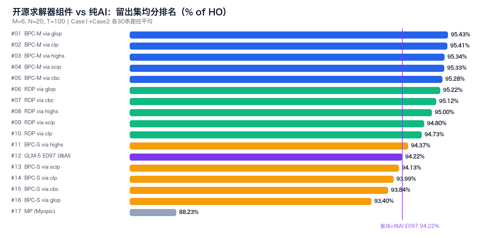

# 开源求解器可选组件实验（Phase 2）

> 对应论文：*Assign-to-Seat: Dynamic Capacity Control for Selling High-Speed Train Tickets*  
> 上级总报告：[`../README.md`](../README.md)（包含 Phase 1 纯 AI 零求解器进化完整报告，冠军策略 `E097`）  
> 本目录目标：不强制硬编码求解器，而是给 AI **增加一个可选组件** `solver_toolkit`（封装本机免费开源的 OR-Tools `GLOP / CLP / CBC / SCIP` 与 `SciPy HiGHS`），**AI 可以调用也可以不调用**，系统量化“加上开源求解器组件后，是否比纯 AI 更好”以及“AI 自主调用组件的真实表现”。

---

## 一、核心结论

1. **百分比口径说明（`% of HO`）**  
   对每条随机到达路径：
   $$\text{收益达成率} = \frac{\text{该方法实际收益}}{\text{HO（事后全知最优收益）}} \times 100\%$$
   Case 1（平稳到达）与 Case 2（短途先来）各在 30 条留出测试路径上取平均，表格中的 **综合均分** 为两个 Case 的算术平均。

2. **加上开源求解器组件后，整体稳定强于纯 AI（`+1.06% ~ +1.21%`）**  
   - 最强组合：**`BPC-M via GLOP` = `95.43%`**（Case 1 `95.82%` / Case 2 `95.04%`），领先第一阶段纯 AI 100 轮进化冠军 `E097`（**`94.22%`**）**`+1.21%`**。
   - 论文全方法强度梯度非常清晰：
     $$\text{BPC-M}\ (95.28\%\text{--}95.43\%) \gtrsim \text{RDP}\ (94.73\%\text{--}95.22\%) > \text{BPC-S}\ (93.40\%\text{--}94.37\%) \approx \text{纯 AI } E097\ (94.22\%) \gg \text{Myopic}\ (88.23\%)$$
   - `E097` 已经能打赢 4 个后端的 `BPC-S`（SCIP/CLP/CBC/GLOP），但在 `BPC-M` 和 `RDP` 面前仍有约 1 个百分点的结构优势差距。

3. **5 大开源后端横向对比：精度几乎一致，速度差 6 倍**  
   - 跑 `BPC-M` 时，5 个开源后端均分全部收束在 **`95.28% ~ 95.43%`**（极差仅 `0.15%`），零商业授权费即可跑出论文级精度；
   - 30 路径耗时（Case 1 / Case 2）：**`HiGHS`（1.0s / 1.2s）≈ `GLOP`（1.4s / 1.6s）≈ `CLP`（1.5s / 1.6s）< `CBC`（2.5s / 2.8s）≪ `SCIP`（7.2s / 7.7s）**。纯 LP 推荐首选 **GLOP 或 HiGHS**。
   - 同为精确 LP 但分数存在 `0.1%~0.9%` 细微差异，源于动态控票 LP 的**退化性与多重最优解**（不同求解器返回不同最优顶点，在临界单处分叉）；其中 `BPC-M` 极差最小（`0.15%`），远稳于 `BPC-S`（极差 `0.97%`）。

4. **AI 自主调用组件实测（4 轮 GLM-5 短跑）与工程避坑**  
   - Prompt 声明“可调用可不调用”时，2 轮有效输出全部主动 `import solver_toolkit`（`used_toolkit=True`）；
   - 暴露出两类典型错误：① **R1（32.74%）**：误传稀疏二元组列表给 `A_ub`，且裸 `except Exception` 吞错触发苛刻回退；② **R3（88.38%）**：成功用纯 list 调通 `GLOP` 解出 BPC-M 对偶，但末尾把“负增益本该 `return None` 拒单”错写成调用启发式强行接单，短路退化成了 Myopic；③ **R2/R4**：智谱高峰期拥堵返回空内容。
   - **改进要点**：给 AI 暴露求解器工具时，必须禁止裸 `except` 静默吞错、在 Prompt 中给出精确入参示例，并把「LP 成功调用率 / 回退率」放进进化诊断反馈表。

---

## 二、留出集 17 组全量对决表（M=6, N=20, T=100，30+30 路径）



| 排名 | 方法 × 后端 | Case 1（占比 / 均收益 / 耗时） | Case 2（占比 / 均收益 / 耗时） | **综合均分** | 相对纯 AI `E097` |
|---:|---|---:|---:|---:|---:|
| **1** | **`BPC-M via GLOP`** | **95.82%** / 893.27 / 1,416.5 ms | **95.04%** / 876.70 / 1,577.0 ms | **95.43%** | **+1.21%** |
| 2 | `BPC-M via CLP` | 95.82% / 893.27 / 1,547.5 ms | 95.01% / 876.37 / 1,635.5 ms | **95.41%** | +1.19% |
| 3 | `BPC-M via HiGHS` | 95.63% / 891.47 / 1,022.0 ms | 95.04% / 876.67 / 1,183.6 ms | **95.34%** | +1.12% |
| 4 | `BPC-M via SCIP` | 95.65% / 891.67 / 7,223.1 ms | 95.01% / 876.43 / 7,706.4 ms | **95.33%** | +1.11% |
| 5 | `BPC-M via CBC` | 95.63% / 891.57 / 2,530.4 ms | 94.92% / 875.60 / 2,822.0 ms | **95.28%** | +1.06% |
| 6 | `RDP via GLOP` | 95.48% / 890.13 / 1,774.6 ms | 94.97% / 876.10 / 1,854.2 ms | **95.22%** | +1.00% |
| 7 | `RDP via CBC` | 95.31% / 888.53 / 3,478.7 ms | 94.92% / 875.63 / 3,987.8 ms | **95.12%** | +0.90% |
| 8 | `RDP via HiGHS` | 95.06% / 886.17 / 1,733.6 ms | 94.95% / 875.87 / 1,804.2 ms | **95.00%** | +0.78% |
| 9 | `RDP via SCIP` | 94.58% / 881.73 / 7,539.2 ms | 95.01% / 876.37 / 7,688.6 ms | **94.80%** | +0.58% |
| 10 | `RDP via CLP` | 94.92% / 884.83 / 2,503.2 ms | 94.55% / 872.13 / 2,485.8 ms | **94.73%** | +0.51% |
| 11 | `BPC-S via HiGHS` | 95.42% / 889.57 / 1,167.9 ms | 93.31% / 860.77 / 1,253.8 ms | **94.37%** | +0.15% |
| **12** | **`GLM-5 E097`（纯 AI 无求解器）** | **94.88%** / 884.43 / **314.3 ms** | **93.57%** / 863.07 / **326.5 ms** | **94.22%** | **0.00%** |
| 13 | `BPC-S via SCIP` | 95.40% / 889.40 / 5,691.7 ms | 92.86% / 856.57 / 5,432.2 ms | **94.13%** | -0.09% |
| 14 | `BPC-S via CLP` | 95.54% / 890.73 / 1,040.6 ms | 92.43% / 852.60 / 976.7 ms | **93.99%** | -0.23% |
| 15 | `BPC-S via CBC` | 95.11% / 886.73 / 2,145.2 ms | 92.58% / 854.07 / 2,056.9 ms | **93.84%** | -0.38% |
| 16 | `BPC-S via GLOP` | 95.23% / 887.93 / 1,018.5 ms | 91.56% / 844.60 / 1,083.0 ms | **93.40%** | -0.82% |
| 17 | `MP`（Myopic 贪心） | 90.54% / 844.37 / 4.6 ms | 85.92% / 792.67 / 4.9 ms | **88.23%** | -5.99% |

原始数值：[`results/all_methods_via_toolkit.json`](results/all_methods_via_toolkit.json) / [`results/optional_solver_component.json`](results/optional_solver_component.json)

---

## 三、组件接口设计（`solver_toolkit.py`）

```python
from solver_toolkit import available_solvers, solve_lp, preferred_lp_solver

print(available_solvers())
# {'scip': True, 'cbc': True, 'glop': True, 'clp': True, 'highs': True, 'ortools': True, 'scipy_highs': True}

res = solve_lp(
    c, A_ub=A, b_ub=b,
    solver="glop",          # 或 "auto" / "scip" / "cbc" / "clp" / "highs"
    time_limit_s=0.5,
)
if res["ok"]:
    x = res["x"]            # 最优解向量
```

---

## 四、代码清单与复现

| 文件 | 说明 |
| :--- | :--- |
| `solver_toolkit.py` | 可选开源求解器组件（统一封装 OR-Tools SCIP/CBC/GLOP/CLP 与 SciPy HiGHS） |
| `seed_bpcm_via_toolkit.py` | 示范策略：`decide` 内通过组件求解论文 BPC-M 对偶 LP |
| `compare_all_via_toolkit.py` | 论文 `MP / BPC-S / BPC-M / RDP` × 全部 5 大后端，与纯 AI `E097` 全量对照 |
| `evolve_with_solver_option.py` | 带可选组件进化脚本（AST 审计仅放行标准库 + `solver_toolkit`，自动统计 `used_toolkit`） |
| `figures/ranking_vs_pure_ai.png` | 17 组方法留出集均分排名柱状图 |
| `results/*.json` | 组件自检、17 组全量对决与 4 轮 GLM-5 短跑进化完整原始数据 |

```bash
pip install --user ortools pulp scipy

# 1) 开源求解器组件自检
python3 solver_toolkit.py

# 2) 论文全方法 × 5 大开源后端全量对照（零 API 成本）
python3 compare_all_via_toolkit.py

# 3) 可选：运行「AI 自由选用组件」进化（需要 GLM_API_KEY）
export GLM_API_KEY="你的智谱Coding_Plan_Key"
python3 evolve_with_solver_option.py --rounds 10 --model glm-5
```
